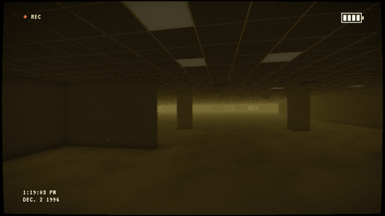
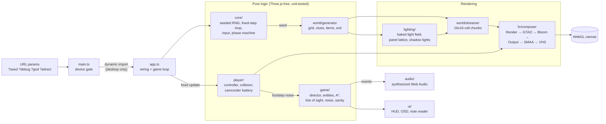

# Backrooms: Level 0

**Found-footage horror in the browser.** A procedural Level 0 of the Backrooms, seen through a 90s VHS camcorder.

[](https://github.com/LuisEduardoGE/backrooms-game/actions/workflows/ci.yml)
[](LICENSE)


[](https://luiseduardoge.github.io/backrooms-game/)



**[Play it now →](https://luiseduardoge.github.io/backrooms-game/)** (desktop, keyboard and mouse; headphones recommended)

## Table of Contents

- [Features](#features)
- [Tech Stack](#tech-stack)
- [Architecture](#architecture)
- [Quick Start](#quick-start)
- [Usage](#usage)
- [Testing](#testing)
- [Project Structure](#project-structure)
- [Deploy](#deploy)
- [Author](#author)
- [License](#license)

## Features

- **Procedural levels**: every tape is a new seeded layout of rooms, corridors and furniture; `?seed=123` replays one.
- **VHS camcorder look**: post-processing for tape noise, chroma bleed, night vision and an on-screen display.
- **Reference-matched materials**: scanned CC0 / CC BY wallpaper, carpet and ceiling textures, real-time shadows.
- **Escalating threats** driven by noise, line of sight and time spent in the level.
- **Synthesized audio**: every sound (hum, footsteps, whispers, threats) is generated with the Web Audio API; no audio files.
- **Fully static**: builds to plain files with relative paths, so it runs on any static host.

## Tech Stack

| Layer | Choice |
|---|---|
| Language | TypeScript 7 (strict) |
| Rendering | Three.js r186, `three/addons` post-processing (GTAO, bloom, SMAA) + a custom VHS shader |
| Audio | Web Audio API (fully synthesized) |
| Build / dev server | Vite 8 |
| Tests | Vitest 4 (Node environment, pure logic) |
| Trailer recorder | puppeteer-core + ffmpeg (`scripts/record-trailer.mjs`) |
| Hosting | GitHub Pages (manual `pages.yml` workflow) |

## Architecture



`main.ts` checks the device and only then loads `app.ts`, so phones never download Three.js. Everything is derived from one run seed: the generator builds a 200×200-cell grid, and named RNG sub-streams place clues, items, lights and threats, so a retry replays the same tape. Each fixed 1/60 s update runs input → player (move, collide, make noise) → director → entities → sanity/battery → audio; the renderer streams chunks around the player and draws through the VHS post-processing chain. Decision logic stays free of Three.js and is covered by the Vitest suite.

## Quick Start

Prerequisites: Node.js 20.19+ or 22.12+ (CI uses Node 22), npm, and `make` (optional).

```bash
make install     # npm ci
make run         # Vite dev server on http://localhost:5180 (PORT=... to change), then click "PLAY TAPE"
```

Without make:

```bash
npm ci
npm run dev
```

Run `make` with no arguments to list all targets (`install`, `run`, `test`, `lint`, `build`, `preview`, `clean`).

## Usage

Follow the painted arrows (not all of them tell the truth) to the wall that doesn't sit right, and walk into it. Batteries keep the camcorder's night vision alive; Almond Water steadies your nerves; the dark wears you down. If the tape ends, retry the same tape or start a new one.

**Something else is here.** At first it only moves the lights. After a few minutes, grinning things wait in the dark rooms and come for noise: crouch to stay quiet. Linger (or keep sprinting) and something tall starts looking for you. Break its line of sight and it may lose you.

### Controls

| Key | Action |
|---|---|
| WASD / mouse | move / look |
| Shift · C | sprint · crouch |
| E | use |
| N | night vision |
| M · Esc | mute · pause |

URL flags: `?seed=123` replay a layout · `?debug` fps and minimap · `?god` no sanity loss or catching · `?attract` demo mode.

## Testing

```bash
make test        # npm test (vitest run)
make lint        # tsc --noEmit
make build       # tsc --noEmit && vite build
```

313 tests in 44 files cover the pure logic: level generation, chunking, solids and wall faces, clues, items and exit, pathfinding and line of sight, noise and hearing, the threat director and entity state machines, sanity, player movement and collision, camcorder battery, lighting samples, audio mix levels, URL params and the device gate. CI runs type-check, tests and build on every push and pull request to `main`.

## Project Structure

```
src/
  main.ts        device gate, lazy-loads the game
  app.ts         renderer, scene, game loop and screens
  core/          fixed-step loop, input, seeded RNG, game phases
  world/         level generator, chunk streaming and meshes, props, clues, items, exit
  lighting/      baked light field, panel lattice, real-time shadow lights
  game/          director, entities, A*, line of sight, noise, sanity
  player/        controller, collision, camcorder
  fx/            post-processing composer and VHS shader
  audio/         synthesized Web Audio engine and mix
  ui/            HUD, OSD, note reader, debug HUD, URL params
  assets/        textures and fonts bundled by Vite
tests/           Vitest suites mirroring src/
public/          models, fonts, trailer.gif, CREDITS.md
scripts/         trailer recorder
docs/            design specs, plans and project notes
```

## Deploy

`make build` (or `npm run build`) produces a static site in `dist/` with relative paths, so it works on any static host or sub-path.

- **GitHub Pages**: enable Pages with source "GitHub Actions", then run the *Deploy to GitHub Pages* workflow from the Actions tab.
- **Vercel / Netlify**: build command `npm run build`, output directory `dist`.
- `npm run trailer` re-records `public/trailer.gif` from `?attract` footage (needs Chrome and ffmpeg).

## Author

**Luis Eduardo G. Espindola** · [GitHub](https://github.com/LuisEduardoGE) · [LinkedIn](https://www.linkedin.com/in/luisgespindola/)

## License

[MIT](LICENSE) © Luis Eduardo G. Espindola

Third-party textures, models and fonts keep their own licenses (CC0, CC BY 4.0, SIL OFL); see [public/CREDITS.md](public/CREDITS.md).
